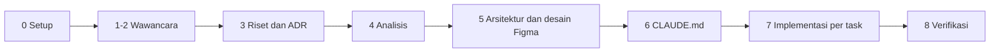

# kickoff

Plugin Claude Code untuk memulai proyek perangkat lunak dengan urutan kerja yang biasa dipakai engineer: wawancara kebutuhan, riset teknologi, dokumentasi, desain antarmuka di Figma, penyusunan `CLAUDE.md`, lalu implementasi per task.

Versi 0.1.0. Lisensi MIT.

## Latar belakang

Kalau coding agent langsung diminta "buatkan aplikasi X", hasilnya memang cepat keluar, tapi sering meleset dari kebutuhan. Agent jarang bertanya, versi library ditulis dari ingatan, dan dokumen tidak lagi cocok dengan kode setelah beberapa iterasi. Masalah lain muncul di sesi yang panjang: begitu context window penuh, kualitas jawaban turun.

Plugin ini memaksa urutan yang berbeda. Claude berperan sebagai engineer atau konsultan, sedangkan pengguna berperan sebagai klien. Setiap fase punya gate, dan fase berikutnya baru dimulai setelah kriterianya terpenuhi dan klien menyetujui hasilnya.

## Alur kerja



Di Fase 0 klien memilih salah satu dari dua alur dokumen:

| Alur | Untuk | Dokumen |
| --- | --- | --- |
| `rpl` | Tugas besar IF2150 Rekayasa Perangkat Lunak ITB, atau proyek yang butuh dokumentasi formal | Topic Brainstorming, Requirement Gathering, Use Case, Class Diagram, SKPL, APL, DPPL, laporan Implementasi |
| `industry` | Proyek pribadi, freelance, atau prototipe startup | PRD, ADR, tech plan, tasks |

Bahasa dokumen mengikuti bahasa klien. Istilah teknis tetap dalam bahasa Inggris.

## Isi plugin

Wawancara berjalan satu pertanyaan per giliran. Pertanyaan tertutup memakai AskUserQuestion, dengan opsi yang disertai trade-off. Bank pertanyaan disediakan per tipe proyek: web, mobile, desktop, API, data/AI, dan lainnya. Agent juga punya checklist untuk kata-kata kabur seperti "cepat" atau "banyak", dan wajib melakukan read-back sebelum fase elisitasi ditutup. Agent dilarang langsung menyetujui ide klien; setiap keputusan besar harus disertai minimal satu risiko atau alternatif.

Kebutuhan fungsional ditulis dengan pola EARS ("Ketika ..., sistem harus ..."). Kebutuhan non-fungsional harus terukur, dan ISO/IEC 25010 dipakai sebagai checklist supaya tidak ada kategori yang terlewat.

Rekomendasi teknologi tidak boleh berasal dari ingatan. Versi library, perintah instalasi, dan nama API diverifikasi lewat Context7 atau dokumentasi resmi, lalu dicatat di `.project/sources.md` dengan ID `S-xx`. Klaim tanpa sumber diberi label `[ASUMSI]`. Keputusan stack ditulis sebagai ADR dengan minimal dua opsi.

Desain antarmuka dibuat langsung di Figma oleh agent melalui [figma-console-mcp](https://github.com/southleft/figma-console-mcp). Urutannya: user flow di FigJam, design token di Variables (mode Light dan Dark), component set dengan variant, wireframe, lalu screen. Setiap frame diberi ID layar dan ID requirement supaya bisa ditelusuri. Setelah UI diimplementasikan, agent membandingkan screenshot Figma dengan hasil render aplikasi.

Traceability dijaga oleh dua script. `check-ids.mjs` mencari ID yang dirujuk di dokumen tetapi tidak terdaftar di registry. `trace-matrix.mjs` membaca komentar `trace: UC03, KF05, C04` di kode dan menyusunnya menjadi tabel Markdown, yang bisa langsung dipakai untuk tabel B.5 laporan Implementasi IF2150.

## Satu sesi untuk satu fase

Interview klien harus berjalan di thread utama, karena subagent tidak bisa bertanya ke pengguna. Implementasi sebaiknya dikerjakan di sesi terpisah untuk setiap task supaya konteksnya tetap kecil. Karena dua hal ini, alurnya memang tidak berjalan otomatis dari awal sampai akhir.

Supaya pergantian sesi tidak terlupa, pengingat muncul di tiga tempat:

1. Hook `SessionStart` menampilkan status proyek dan aturan sesi setiap kali sesi dibuka.
2. Setiap fase yang lolos gate dan setiap task yang selesai ditutup dengan `/kickoff:handoff`. Perintah ini menulis `.project/handoff.md` dan meminta pengguna membuka sesi baru.
3. `/kickoff:implement` menolak melanjutkan pekerjaan kalau sesi yang sedang berjalan sudah dipakai untuk hal lain.

Sesi baru cukup membaca `.project/state.md` dan `.project/handoff.md` untuk melanjutkan pekerjaan.

## Instalasi

Prasyarat:

- Claude Code versi terbaru
- Node.js, untuk hook, script, dan `npx`
- Figma Desktop, untuk fase desain (versi browser tidak bisa terhubung ke Desktop Bridge)

Pasang plugin dari dalam Claude Code:

```text
/plugin marketplace add <username-github>/kickoff
/plugin install kickoff@kickoff-marketplace
```

Restart Claude Code, lalu periksa dengan `/plugin`. Untuk mencoba dari folder lokal tanpa marketplace:

```bash
claude --plugin-dir ./kickoff
```

### MCP pendukung

figma-console dibutuhkan untuk fase desain. Tambahkan ke konfigurasi MCP Claude Code:

```json
{
  "mcpServers": {
    "figma-console": {
      "command": "npx",
      "args": ["-y", "figma-console-mcp@1.39.1"]
    }
  }
}
```

Setelah itu, impor dan jalankan plugin Figma Desktop Bridge di Figma Desktop. Cara impor plugin dan kebutuhan token akses bisa berbeda antarversi, jadi ikuti README figma-console-mcp untuk versi yang terpasang.

Context7 tidak wajib tetapi disarankan, karena verifikasi versi library jadi jauh lebih andal:

```bash
claude mcp add --scope user context7 -- npx -y @upstash/context7-mcp
```

Tanpa Context7, agent memakai WebFetch dan WebSearch.

Untuk memeriksa struktur plugin:

```bash
claude plugin validate ./kickoff
```

## Penggunaan

Buka folder kosong untuk proyek baru, jalankan `claude`, lalu:

```text
/kickoff:kickoff aplikasi pencatatan stok untuk warung kelontong
```

Agent akan membuat folder `.project/`. Setelah itu agent menanyakan bahasa dokumen, alur dokumen, dan tipe proyek. Untuk alur `rpl`, agent juga menanyakan identitas kelompok dan deadline. Setelahnya wawancara discovery dimulai.

Di sesi berikutnya, status proyek muncul otomatis. Untuk melanjutkan:

```text
/kickoff:kickoff lanjut
```

| Perintah | Fungsi |
| --- | --- |
| `/kickoff:kickoff [ide \| lanjut]` | Orkestrator. Memulai proyek atau melanjutkan fase aktif. |
| `/kickoff:interview` | Wawancara discovery dan elisitasi kebutuhan. |
| `/kickoff:research` | Riset bersumber dan penulisan ADR. |
| `/kickoff:docs-rpl` | Dokumen alur IF2150. |
| `/kickoff:docs-industry` | PRD, ADR, tech plan, dan tasks. |
| `/kickoff:figma-design` | FigJam flow, token, komponen, screen, dan parity check. |
| `/kickoff:claude-md` | Membuat atau memperbarui `CLAUDE.md` dan `.claude/rules/`. |
| `/kickoff:implement [T-xx \| UCxx]` | Mengerjakan satu task. |
| `/kickoff:gate` | Memeriksa kriteria fase melalui subagent reviewer. |
| `/kickoff:trace` | Menyusun ulang matriks traceability. |
| `/kickoff:handoff [selesai \| sebagian]` | Menulis catatan serah terima dan mengingatkan pengguna untuk membuka sesi baru. |

Semua skill dari plugin memakai namespace `kickoff:`. Hanya `kickoff:kickoff` yang harus dipanggil manual; skill lain juga bisa dimuat otomatis oleh Claude kalau relevan.

## Fase dan gate

| Fase | Alur `rpl` | Alur `industry` | Contoh kriteria gate |
| --- | --- | --- | --- |
| 0 Setup | Identitas kelompok, konvensi ID | Bahasa, tipe proyek | Alur dipilih secara eksplisit oleh klien |
| 1 Discovery | Topic Brainstorming | PRD bagian masalah dan tujuan | Klien menyetujui read-back |
| 2 Elisitasi | Requirement Gathering | PRD lengkap | Semua KF Must ditulis dalam EARS, tidak ada asumsi terbuka |
| 3 Riset | Sumber dan ADR | ADR | Tidak ada versi library tanpa sumber |
| 4 Analisis | Use Case, Class Diagram, SKPL | Tech plan | Setiap KF tercakup use case, `check-ids` tanpa error |
| 5 Desain | APL, Figma, DPPL | Tech plan, Figma, tasks | Setiap skenario punya sequence diagram, desain disetujui klien |
| 6 CLAUDE.md | Ya | Ya | Maksimal 200 baris, semua perintah sudah diuji |
| 7 Implementasi | `src/` dan laporan Tugas 9 | Kode dan tasks | Test lulus, trace tag ada |
| 8 Verifikasi | Traceability B.5, profiling | Review akhir | Semua use case Must terimplementasi atau tercatat alasannya |

## File yang dibuat di proyek

```text
.project/
  state.md            fase aktif, alur, bahasa, status gate, penghitung ID
  handoff.md          catatan serah terima antarsesi
  interview-log.md    tanya-jawab dengan klien, dikutip apa adanya
  assumptions.md      asumsi dan risiko (ASM-xx)
  sources.md          sumber riset (S-xx)
docs/
  00-id-registry.md   daftar seluruh ID proyek
  KXX_GYY_*.md        dokumen alur rpl, atau PRD.md, tech-plan.md, tasks.md untuk alur industry
  adr/                ADR-001-*.md dan seterusnya
  assets/             diagram dan screenshot UI
CLAUDE.md
.claude/rules/        docs.md, code.md, testing.md (dimuat sesuai path)
```

## Struktur plugin

```text
.claude-plugin/       plugin.json, marketplace.json
skills/
  kickoff/            orkestrator
  interview/          teknik elisitasi, checklist ambiguitas, bank pertanyaan
  research/           aturan verifikasi sumber dan ADR
  docs-rpl/           template IF2150, skema ID, panduan diagram Mermaid, ringkasan pola arsitektur
  docs-industry/      template PRD, ADR, tech plan, tasks
  figma-design/       preflight, FigJam, token, komponen, parity
  claude-md/          template CLAUDE.md dan rules
  implement/
  gate/
  trace/
  handoff/
agents/
  researcher.md       riset bersumber (sonnet)
  architect.md        draf arsitektur dan kelas desain (opus)
  designer.md         eksekusi di Figma lewat figma-console (sonnet)
  reviewer.md         pemeriksa read-only untuk gate (sonnet)
hooks/hooks.json      SessionStart, menampilkan ringkasan status
scripts/              state-summary, init-project, check-ids, trace-matrix
```

## Kustomisasi

Template IF2150 tersimpan di `skills/docs-rpl/assets/templates/` dan diikuti apa adanya. Kalau asisten merilis versi baru, cukup ganti file di folder itu.

Kalau kelompok memakai pola ID lain, ubah `skills/docs-rpl/references/id-scheme.md` dan regex `PATTERN` di `scripts/check-ids.mjs`. Template asli memakai `A01` untuk aktivitas di Requirement Gathering sekaligus untuk aktor di SKPL. Karena bentrok, agent akan menanyakan konvensi yang dipakai di Fase 0.

Untuk menambah tipe proyek, buat file baru di `skills/interview/references/question-banks/`. Model setiap subagent diatur lewat field `model` di `agents/*.md`.

## Troubleshooting

| Gejala | Kemungkinan penyebab | Solusi |
| --- | --- | --- |
| Status proyek tidak muncul saat sesi dibuka | Node.js tidak ada di PATH, atau `.project/state.md` belum dibuat | Pasang Node.js, lalu jalankan `/kickoff:kickoff` sekali |
| Designer melaporkan Figma tidak terhubung | Desktop Bridge belum berjalan, atau yang dibuka adalah Figma versi browser | Buka Figma Desktop dan jalankan plugin Desktop Bridge |
| Nama tool Figma tidak ditemukan | Versi figma-console berbeda | Pin versi di konfigurasi MCP; skill menyesuaikan dengan tool yang tersedia |
| Skill tidak terpanggil otomatis | Deskripsi skill tidak cocok dengan permintaan | Panggil manual dengan `/kickoff:<nama>` |
| `check-ids` melaporkan error padahal ID dipakai | ID belum ada di `docs/00-id-registry.md` | Daftarkan ID di kolom pertama tabel registry |

## Batasan

Plugin ini tidak menjalankan `git commit`, `push`, atau membuat pull request kecuali pengguna memintanya.

Kualitas hasil wawancara bergantung pada jawaban klien. Kalau semua rekomendasi diterima tanpa koreksi, yang terdokumentasi adalah rencana buatan agent, bukan kebutuhan yang sebenarnya.

Gambar dan foto di desain Figma berupa placeholder. Template IF2150 di repo ini disalin dari spesifikasi semester berjalan, jadi selalu cocokkan dengan versi terbaru dari asisten.

## Referensi

Beberapa ide alur diadaptasi dari proyek lain:

- [Superpowers](https://github.com/obra/superpowers): satu pertanyaan per giliran dan gate sebelum menulis kode
- [GitHub Spec Kit](https://github.com/github/spec-kit): constitution, clarify, dan analyze lintas artefak
- [Kiro](https://kiro.dev): requirement EARS dan task yang merujuk ID requirement
- [BMAD Method](https://github.com/bmad-code-org/BMAD-METHOD): pemecahan dokumen per story dan sesi baru per task

Praktik "wawancara dulu, eksekusi di sesi baru" berasal dari anjuran tim Claude Code.

## Lisensi

[MIT](LICENSE)
