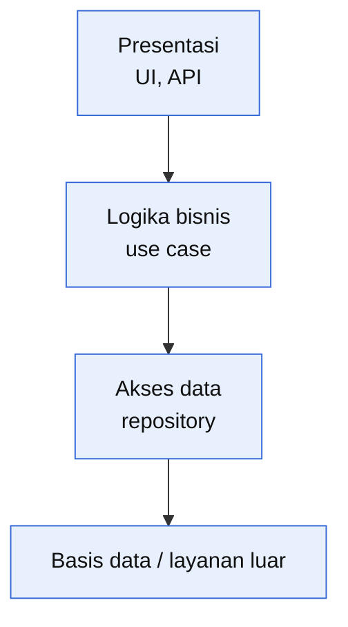

# Cheatsheet Arsitektur (dari materi kuliah)

| Pola | Inti | Cocok untuk | Kelebihan | Kekurangan |
| --- | --- | --- | --- | --- |
| **MVC** | Model (data), View (tampilan), Controller (alur) dipisah | Aplikasi interaktif dengan banyak tampilan | Satu data banyak tampilan, mudah diuji | Kompleks untuk aplikasi sederhana |
| **Repository** (berpusat data) | Komponen berbagi satu penyimpanan data pusat | Sistem yang banyak alat mengolah data bersama | Berbagi data efisien | Repository menjadi titik gagal dan perubahan skema berdampak luas |
| **Pipe and filter** | Data mengalir lewat rangkaian filter independen | Pemrosesan data berurutan (ETL, kompilator) | Mudah disusun ulang, paralel | Kurang cocok untuk interaksi, format data antar filter harus disepakati |
| **Microservices** | Banyak layanan kecil, masing-masing mandiri dan dideploy sendiri | Sistem besar, tim banyak, skalabilitas berbeda tiap bagian | Skala dan deploy per layanan, toleransi gagal | Kompleksitas operasional, latensi jaringan, konsistensi data sulit |
| **Event-driven / publish-subscribe** | Komponen berkomunikasi lewat peristiwa | Sistem reaktif, notifikasi, integrasi longgar | Kopling longgar | Alur sulit dilacak dan di-debug |
| **Monolit** | Satu kesatuan yang dideploy bersama | Sistem kecil sampai menengah, tim kecil | Sederhana, mudah dideploy dan diuji | Sulit diskalakan sebagian, perubahan kecil memaksa deploy ulang semuanya |

### Arsitektur berlapis

Panah dependensi hanya turun: lapisan atas boleh memakai lapisan di bawahnya, bukan sebaliknya.

### Atribut kualitas dan taktik

| Atribut | Arti | Taktik arsitektural contoh |
| --- | --- | --- |
| Kinerja | Waktu respons, throughput | Cache, replikasi, pemrosesan paralel, antrean |
| Ketersediaan | Sistem siap saat dibutuhkan | Redundansi, *failover*, pemantauan kesehatan |
| Keamanan | Melindungi data dan akses | Autentikasi, otorisasi, enkripsi, pemisahan zona |
| Kemudahan diubah (*modifiability*) | Biaya perubahan | Modul dengan kopling longgar, antarmuka stabil |
| Kemudahan diuji | Mudah diuji | Dependensi bisa disuntik, modul kecil |
| Kebergunaan | Mudah dipakai | Umpan balik, pemisahan UI dari logika |
| Interoperabilitas | Bekerja dengan sistem lain | Antarmuka standar, adapter |

Atribut sering **bertentangan**: enkripsi berlapis menaikkan keamanan tetapi menurunkan kinerja, cache menaikkan kinerja tetapi menyulitkan konsistensi. Jawaban yang kuat menyebut pertentangan itu dan memilih secara sadar.

### Pandangan arsitektur (4+1, Kruchten)
**Logical** (kelas dan paket), **process** (konkurensi dan alur kendali), **development** (modul dan struktur kode), **physical** (penyebaran ke perangkat keras), **scenarios** (use case yang menyatukan keempatnya).

### Kohesi dan kopling
Desain yang baik punya **kohesi tinggi** dan **kopling rendah**. Instabilitas modul:

$$I = \frac{C_e}{C_a + C_e}, \qquad 0 \le I \le 1$$

$C_e$ = jumlah modul lain yang dipakai modul ini, $C_a$ = jumlah modul lain yang memakai modul ini. $I \to 0$ stabil, $I \to 1$ mudah berubah. Contoh: $C_e = 3$, $C_a = 1$, maka $I = 0{,}75$.

### Hitungan ketersediaan

$$A = \frac{\text{MTBF}}{\text{MTBF} + \text{MTTR}}, \qquad A_{\text{seri}} = \prod A_i, \qquad A_{\text{paralel}} = 1 - \prod (1 - A_i)$$

Contoh: MTBF 400 jam, MTTR 4 jam, maka $A \approx 0{,}9901$. Seri 0,99 x 0,98 = 0,9702. Paralel dua server 0,95 = 0,9975. Waktu henti per tahun = $(1 - A) \times 8760$ jam, misalnya 99,5% = 43,8 jam.
