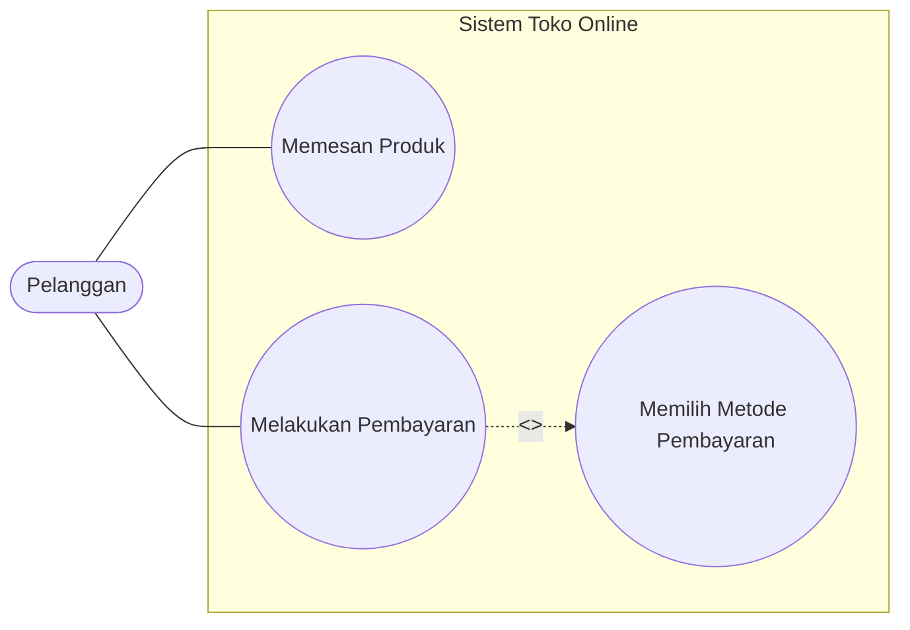
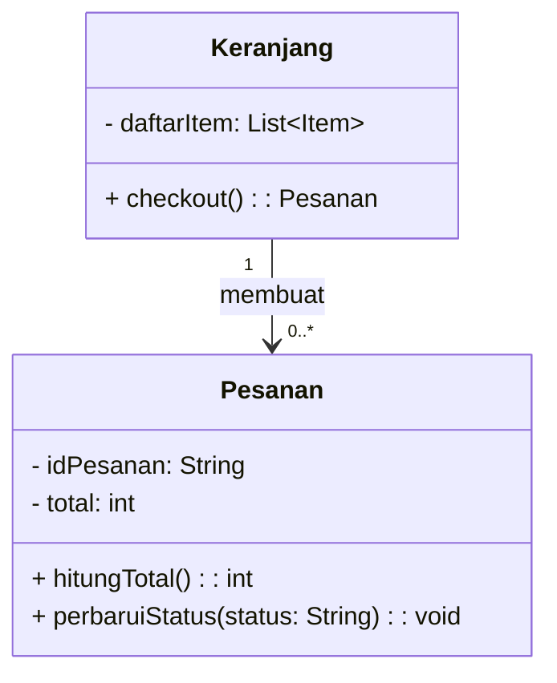

# Diagram UML dengan Mermaid (render di GitHub)

GitHub merender blok ```` ```mermaid ```` secara native. PlantUML tidak dirender native di GitHub dan harus diekspor ke gambar dulu.

| Diagram | Cara |
| --- | --- |
| Activity / proses bisnis | `flowchart TB` dengan `subgraph` per aktor sebagai swimlane |
| Use case | `flowchart LR`: aktor sebagai node `A01(["Pelanggan"])`, use case `UC01(("Memesan Produk"))`, batas sistem sebagai `subgraph`, relasi `-.->|"<<include>>"|` |
| Class | `classDiagram` dengan visibilitas `+ - #`, tipe, multiplisitas `"1" --> "*"` |
| Sequence | `sequenceDiagram` dengan `alt/else` untuk skenario alternatif, atau satu diagram per skenario sesuai template DPPL |
| State | `stateDiagram-v2` |
| Logical/physical view | `flowchart` dengan subgraph per lapisan/node, setiap panah diberi label |

Catatan: Mermaid versi baru punya diagram use case khusus, tetapi belum tentu sudah dirender oleh GitHub. Pakai pendekatan flowchart di atas, kecuali klien atau asisten meminta notasi UML baku. Dalam kasus itu, buat sumber PlantUML di `docs/diagrams/*.puml`, render ke PNG/SVG, lalu sisipkan gambarnya dengan pola `<p align="center"></p>` seperti di template.

Jika template meminta gambar (bukan blok kode), render Mermaid ke SVG/PNG (misalnya dengan `npx -y @mermaid-js/mermaid-cli -i x.mmd -o x.svg`, verifikasi perintahnya dulu lewat skill `research`) dan simpan di `docs/assets/diagram/`.

## Contoh use case diagram


## Contoh class diagram (DPPL)

